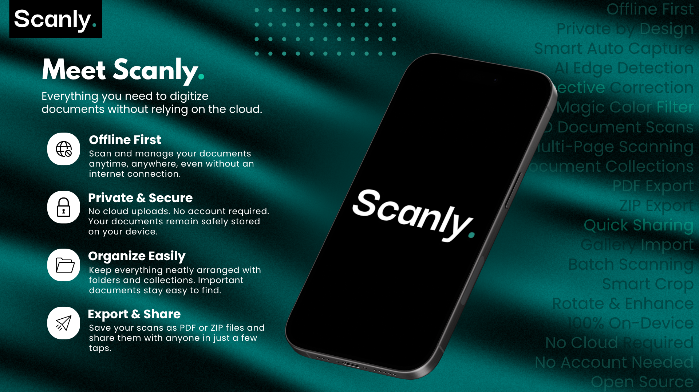
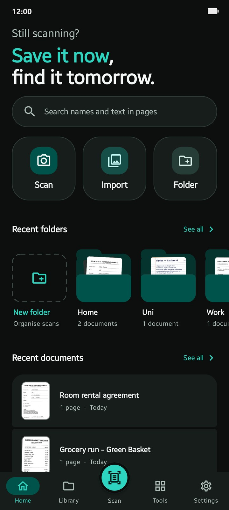
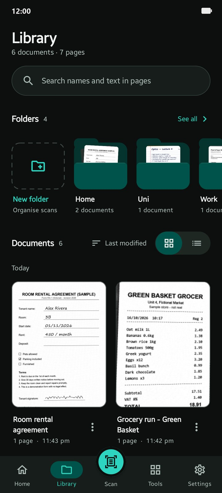
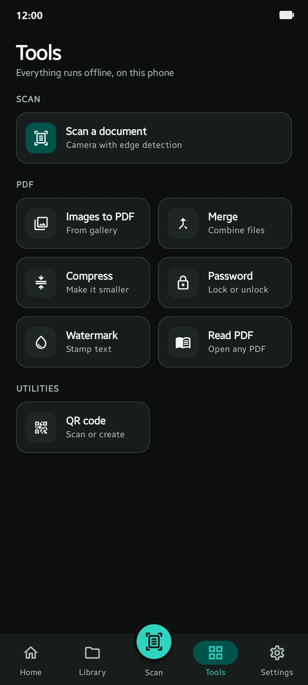
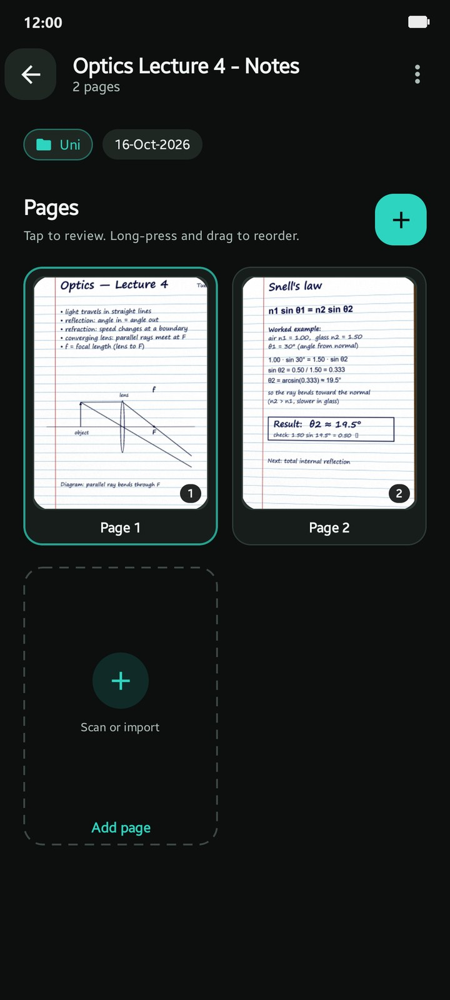
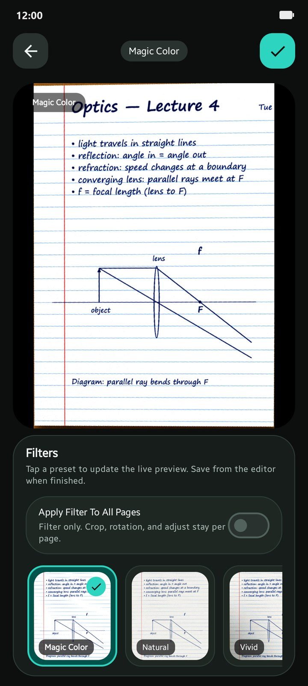
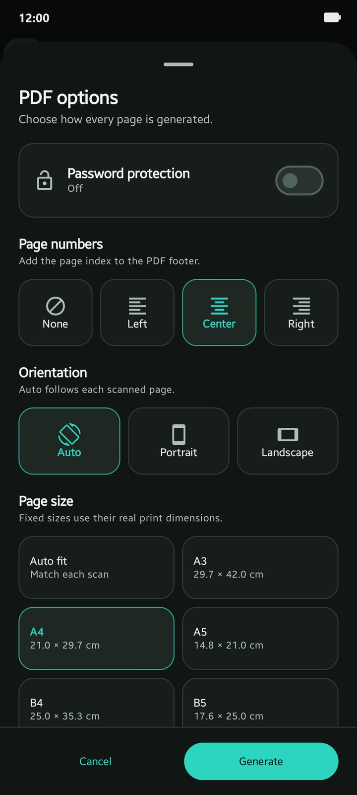
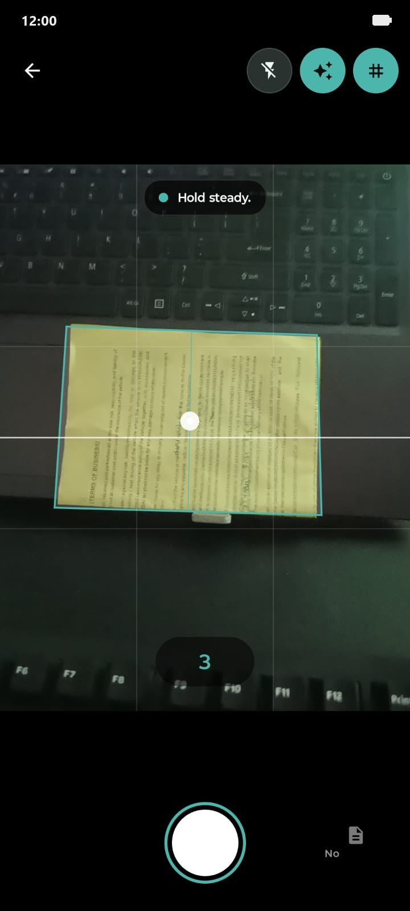

# Scanly

**[Website](https://www.usescanly.co.in)** · **[Get it on Google Play](https://play.google.com/store/apps/details?id=in.c1ph3rj.scanly)** · **[Docs](https://www.usescanly.co.in/docs)** · **[Privacy](https://www.usescanly.co.in/privacy-policy)**

<p align="center">
  
</p>

Scanly is a free, open-source, offline-first **document scanner for Android** — scan paper, receipts, notes, and ID cards into clean PDFs on your phone with no account, no ads, no watermark, and no cloud upload. Built with Kotlin, Jetpack Compose, and Material 3.

It is designed for a practical, local-only scanning workflow:

1. capture a document with the camera or import images from the gallery
2. detect and correct page geometry
3. refine pages with editing tools
4. store and organize multi-page documents locally, including collections
5. export as PDF or image sets

## Why Scanly

- **Works fully offline** — scanning, editing, storage, and export run on your device.
- **No account or sign-up** — open the app and start scanning.
- **No ads, no watermark, and no subscription** for core scanning.
- **Documents stay on your device** until you export or share them.
- **Open source (AGPL-3.0-only)** — the privacy claims are verifiable in the code.
- **A privacy-first alternative** to cloud scanners like CamScanner, Adobe Scan, and the retired Microsoft Lens (Microsoft retired Lens in early 2026).

## Download

- **Google Play:** [Scanly on Google Play](https://play.google.com/store/apps/details?id=in.c1ph3rj.scanly)
- **Website:** [www.usescanly.co.in](https://www.usescanly.co.in)

## Highlights

- offline-first by default
- document library with searchable collections (groups), paper-shaped cards, and a recent-item home dashboard
- manual camera capture with live document guidance, multi-model corner detection, and a physical-document semantic gate
- import images from the gallery to create or extend documents
- page editor with live cropped preview, full-screen filters/adjust, and a crop screen (AI Detect, rotate, handles)
- document filters (Magic Color, Natural, Vivid, Screen, Grayscale, B&W, Whiteboard, Faded Text, and Auto) with an adjustable intensity; paper presets use a paper-aware lighting model, and Screen and Vivid use global color looks
- in-app PDF reader (title, page n of m, paged or continuous, pinch-zoom) and offline PDF tools (merge, compress, password, watermark)
- Advanced PDF export/share with password protection, page numbering, auto orientation, print sizes, margins, and group-level export
- direct export saving to `Downloads/Scanly` or a user-selected folder
- compressed `.scanly` library backup and Replace/Merge restore under the dedicated `backup/` folder
- settings with look & feel (including pure black AMOLED), configurable document detection models, storage usage, clear-all-data, FAQs, and license info

**Current version:** `1.0.17` (version code `17`) — see [VERSION.md](VERSION.md) and [CHANGELOG.md](CHANGELOG.md).

## Screenshots

### Mobile

<table>
  <tr>
	<td></td>
	<td></td>
	<td></td>
  </tr>
  <tr>
	<td></td>
	<td></td>
	<td></td>
  </tr>
  <tr>
	<td></td>
	<td></td>
	<td></td>
  </tr>
</table>

## Tech Stack

- Kotlin
- Jetpack Compose + Material 3
- Hilt
- Navigation Compose
- CameraX
- Room
- DataStore
- LiteRT
- OpenCV
- Coroutines and Flow

## Project Structure

- `app/` – Android application source and module build files
- `docs/` – complete project documentation (start at [docs/README.md](docs/README.md))
- `scanly-web/` – separately versioned React website checkout that renders GitHub-backed marketing content and these docs — live at https://www.usescanly.co.in
- `gradle/` – wrapper and version catalog configuration

## Current Architecture

The repository is organized as a production-style single-module app:

- `:app` is the only Android module
- entry point: `app/src/main/java/in/c1ph3rj/scanly/MainActivity.kt`
- app wiring: `ScanlyApplication`, navigation, Hilt modules, feature screens, and domain/data layers live under `app/src/main/java/in/c1ph3rj/scanly/`
- local data: Room, DataStore, app-private file storage, and portable `.scanly` archives
- camera and processing stack: CameraX, LiteRT, and OpenCV-based page processing

## Build and Run

From the repository root on Windows:

```powershell
./gradlew.bat assembleDebug
./gradlew.bat testDebugUnitTest
```

Install on a connected device or emulator (`adb devices` must show `device`):

```powershell
./gradlew.bat installDebug
./gradlew.bat connectedDebugAndroidTest
```

Full run, emulator, and test-suite instructions: [docs/development/running-and-testing.md](docs/development/running-and-testing.md).

For an additional verification pass:

```powershell
./gradlew.bat lintDebug
```

## Documentation

**Full documentation lives in [`docs/`](docs/).** Start at [docs/README.md](docs/README.md) for complete project context.

| Document | Purpose |
| --- | --- |
| [docs/README.md](docs/README.md) | Documentation index and reading paths |
| [docs/overview/](docs/overview/) | What Scanly is, features, user guide |
| [docs/architecture/](docs/architecture/) | Layers, navigation, screens |
| [docs/data/](docs/data/) | Room database, file storage, settings |
| [docs/processing/](docs/processing/) | Capture, ML, filters, export |
| [docs/development/](docs/development/) | Setup, conventions, testing, releasing |
| [docs/reference/](docs/reference/) | Models, use cases, tech stack |
| [VERSION.md](VERSION.md) | Release metadata and upgrade notes |
| [CHANGELOG.md](CHANGELOG.md) | User-facing release history |
| [CONTRIBUTING.md](CONTRIBUTING.md) | Contribution workflow |
| [SECURITY.md](SECURITY.md) | Vulnerability reporting |
| [Agents.md](Agents.md) | AI coding agent guidance |
| [LICENSE](LICENSE) | GNU AGPL-3.0-only |

## Links

- Website: [https://www.usescanly.co.in](https://www.usescanly.co.in)
- Google Play: [https://play.google.com/store/apps/details?id=in.c1ph3rj.scanly](https://play.google.com/store/apps/details?id=in.c1ph3rj.scanly)
- Docs: [https://www.usescanly.co.in/docs](https://www.usescanly.co.in/docs)
- llms.txt (AI-readable summary): [https://www.usescanly.co.in/llms.txt](https://www.usescanly.co.in/llms.txt)
- Privacy policy: [https://www.usescanly.co.in/privacy-policy](https://www.usescanly.co.in/privacy-policy)
- Terms: [https://www.usescanly.co.in/terms-and-conditions](https://www.usescanly.co.in/terms-and-conditions)
- Source: [https://github.com/c1ph3rj/Scanly](https://github.com/c1ph3rj/Scanly)

## License

Scanly source code in this repository is licensed under `AGPL-3.0-only`.

Third-party dependencies and model assets can have their own license terms. Review
`app/src/main/assets/settings/licenses.json` and upstream sources before redistribution.

## Project Principles

- offline-first by default
- preserve raw captures and avoid destructive edits
- keep manual controls available even when automation is imperfect
- prefer small, testable domain and data boundaries

## Contributing

Before sending changes, run the Gradle checks above and keep new code aligned with the existing package structure under `in.c1ph3rj.scanly`.

If you are planning a change that affects public behavior, update the relevant docs in `docs/` and [CHANGELOG.md](CHANGELOG.md) before or alongside the code change.

